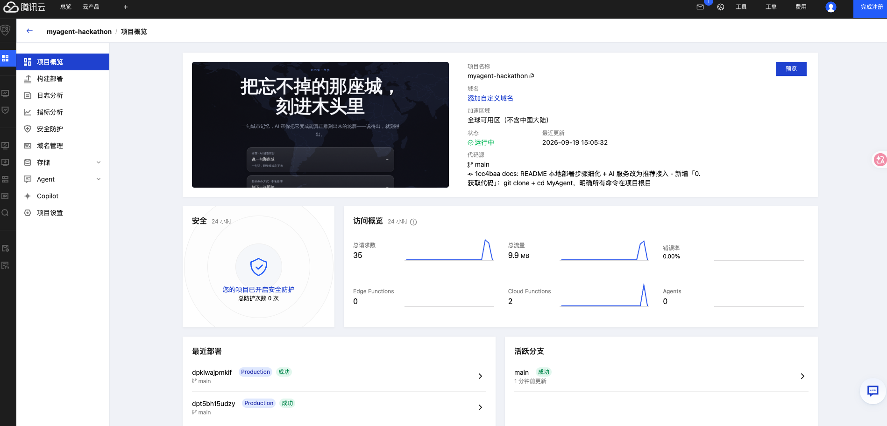

# 建筑木刻师 Architecture Woodcarver · 把那栋你忘不掉的楼，刻下来

> 你只要说一句关于那栋建筑的话。AI 把它变成一个能真的被激光机切出来的镂空矢量稿。
> 情绪交给 AI，几何交给算法。

---

## 它在做什么

每个人心里，都有一栋「忘不掉、却带不走」的楼——住过的老屋、楼下的小店、某个城市里再也回不去的那栋建筑。

建筑木刻师要做的，是把这份「带不走」变成「带得走」。你不需要会画图，不需要懂激光切割，甚至不需要知道 SVG 是什么——你只需要**说一句关于那栋建筑的话**。剩下的，AI 会一路想到「能制造为止」：

1. **听懂那栋建筑**。从你的一句话里识别出具体的地标建筑（巴黎埃菲尔铁塔、悉尼歌剧院……），同名歧义时让你点选确认，绝不猜错。
2. **生成镂空图案**。把建筑变成一份「黑色实心 + 白色镂空细节」的剪纸雕刻风图案，而不是一张普通图片。
3. **按三层激光工艺输出 SVG**。切穿（cut）/ 划线（score）/ 雕刻（engrave）三层语义清晰，直接喂给激光机就能刻。

> 注：早期版本会先搜真实照片再做「忠实还原」，因效果不稳定已暂时关闭，当前直接由 AI 文生图生成镂空图案（链路见「架构」）。

首页左侧是标题与入口，右侧是一段「说一句 → AI 生成 → 建筑镂空 → SVG 代码」的自循环动画，让你第一眼就明白这个场景能做什么。

---

## 核心工作流

### 说一句那栋楼

> 输入「我想念巴黎埃菲尔铁塔的轮廓」，得到一张可制造的激光镂空 SVG。

这条链路里，AI 不只是「画一张图」，而是**一个有思考过程的智能体**：

1. **地点解析**。本地别名索引优先命中，命中不了再由 DeepSeek 兜底；多城市、归属冲突（如「巴黎的悉尼歌剧院」）会被识别出来，提示你确认，不静默猜错。
2. **生成镂空图案**。AI 把建筑生成为「黑色实心块 + 白色镂空细节」的单连通 stencil 剪纸风图案（填充雕刻友好，不是线稿描线）。
3. **Potrace 矢量化**。把图案追踪成闭合复合矢量轮廓（`fill-rule=evenodd`），落在填充雕刻层。
4. **材料布尔合并**。相框、横条、建筑轮廓通过布尔并集焊成一个整体外轮廓 + 内孔，消除内部重叠边，材料真正连成一体。
5. **制造校验（DFM）**。结果必须通过基于真实激光设备参数的制造检查（含材料连通性检查：无孤岛、无弱连接），不合格就明确标注原因，并可保存为草稿。
6. **失败即报错**。没配图像 API、或生成失败？直接返回明确错误提示，不用糊弄的兜底结果。

---

## 让人眼前一亮的几个细节

- **双 AI 模型协同**。DeepSeek 负责「想」（地点识别），Qwen-Image 负责「画」（镂空图案），各司其职。
- **材料是真的连成一体的**。生成结果会做连通域分析（§7.3）与布尔合并（§7.2），保证雕刻后相框、横条、建筑、城市名不会散架——这是「AI 画的图」与「能刻的镂空」之间的关键一步。
- **制造检查结果看得见**。结果页明确展示「制造检查通过/未通过」及具体原因；未通过时可保存为草稿，不再只给一个点不动的灰按钮。
- **AI 会失败，但你不必等**。多层降级让产品在无 key、无网络、AI 报错时依然给出明确反馈。
- **生成后还能调**。结果出来后，可以改建筑下方的城市名文字、切换横/竖幅，只重排版字形、不动建筑；支持撤销/恢复原版、对比上一版，刷新也不丢。
- **Apple 流体交互**。毛玻璃材质、弹簧物理按压、逐笔描画揭示、下载成功弹跳、错误抖动入场。
- **中英双语**。顶栏「中 / EN」一键切换，全部界面即时翻译。
- **点击放大预览**。结果镂空图点击即可全屏放大查看，点叉号、空白处或按 Esc 关闭。
- **一键分享小红书**。canvas 原生重画 SVG（不经过 Image，规避 Safari 的 canvas 污染），直接生成 PNG + 带话题文案，复制即发。
- **接口限流防刷**。花钱的 AI 接口按 IP 做了限流，超频直接返回 `429`，挡住脚本盗刷额度。密钥只走服务端，永不进前端。

---

## 线上访问

项目已部署到腾讯云 **EdgeOne Pages**（Next.js 全栈应用，API 走 Cloud Functions），并绑定自定义域名提供稳定公开访问。

> **🔗 正式入口已上线（地址隐去）。如需访问，请通过仓库 Issues 或邮件留言，作者会提供访问链接。**

体验全部功能（AI 思考回放 + 镂空 SVG/PNG 下载），无需本地部署。下图为 EdgeOne 控制台的项目概览实况：



- **自动构建**：`git push` 到 `main` 分支后，EdgeOne 自动拉取、构建并发布最新版本，正式域名始终指向最新部署。
- **AI 能力完整**：EdgeOne 函数执行时长上限已放宽至 120 秒，足以覆盖「场景 ReAct + 生图」的完整链路。
- **HTTPS**：已启用免费证书，浏览器无安全告警。

> 本地运行（下方章节）仅作为二次开发、离线演示或自定义修改时的备用方式，评审体验优先使用线上入口。

---

## 本地运行（完整步骤）

从零开始，照着做就能跑起来。所有命令都在**项目根目录**下执行。

### 0. 获取代码

先克隆仓库，并进入项目目录：

```bash
git clone https://github.com/myandraya/MyAgent.git
cd MyAgent
```

> 之后的所有命令，都在这个 `MyAgent/` 目录（项目根目录）里执行。可以用 `pwd` 确认当前路径，应该看到它以 `/MyAgent` 结尾。

### 1. 前置要求

- **Node.js 22.18+**（项目在 `package.json` 里声明了 `engines.node >= 22.18`）。推荐用 [nvm](https://github.com/nvm-sh/nvm) 管理版本：

  ```bash
  nvm install 22
  nvm use 22
  node -v   # 应输出 v22.x.x
  ```

- **npm**（随 Node 一起安装）。无需数据库、无需任何外部服务——本项目是纯 Next.js 应用，全部数据在内存和本地文件里。

### 2. 安装依赖

```bash
npm install
```

（首次会下载几十 MB 依赖，耐心等它跑完，出现命令行提示符即为成功。）

### 3. 启动开发服务器

```bash
npm run dev
```

打开浏览器访问 `http://localhost:3000` 即可。

> **兜底说明**：文字入口依赖 AI 生图，未配置 key 时返回明确错误提示。**要完整展示建筑木刻师的能力，请按下一步接入真实 AI key。**

### 4.（推荐）接入真实 AI 服务

**强烈建议接入。** 建筑木刻师的核心卖点——AI 思考回放（DeepSeek ReAct）、AI 生成建筑镂空图案（Qwen-Image）——都依赖真实 AI key。不配 key 虽然也能跑通基础流程，但会退化成纯本地确定性算法，**演示效果会大打折扣**。要展示全部功能，请务必配置。

复制模板并填入真实 key：

```bash
cp .env.example .env.local
```

然后编辑 `.env.local`：

```dotenv
# DeepSeek —— 负责「想」：建筑识别 + ReAct 选景
DEEPSEEK_API_KEY=sk-your-real-key
DEEPSEEK_MODEL=deepseek-flash

# 阿里云百炼 Qwen-Image —— 负责「画」：镂空图案生成
DASHSCOPE_API_KEY=sk-your-dashscope-key
DASHSCOPE_WORKSPACE_ID=your-workspace-id   # 可选，专属端点时填
QWEN_IMAGE_MODEL=qwen-image-3.0            # 可选，默认 qwen-image-3.0
```

Key 获取：

- DeepSeek key：https://platform.deepseek.com/
- Qwen-Image key：https://bailian.console.aliyun.com/（百炼控制台）

> ⚠️ 密钥只由服务端（API Route）读取，**禁止**加 `NEXT_PUBLIC_` 前缀，否则会打包进前端泄露。`.env.local` 已在 `.gitignore` 中忽略，不会进仓库。两个 key 都缺失时，链路自动降级到本地确定性算法。

### 模型可以替换吗？

可以。建筑木刻师的 AI 能力分「想」和「画」两块，可替换程度不同：

| 环节 | 当前实现 | 接口协议 | 替换难度 |
|------|---------|---------|---------|
| **「想」建筑识别 + ReAct** | DeepSeek（`lib/deepseek.ts`） | **OpenAI 兼容** `/chat/completions` | **易**——改 base URL + 模型名即可 |
| **「画」镂空图案生成** | 阿里云百炼 Qwen-Image（`lib/image-gen.ts`） | DashScope 专有接口 | **较难**——需重写调用层 |

**DeepSeek 换起来很简单**：`lib/deepseek.ts` 调的是标准的 OpenAI 兼容 `chat/completions` 协议，任何支持该协议 + **JSON 输出模式（`response_format: json_object`）**的模型都能直接替换，例如 OpenAI GPT、Moonshot Kimi、智谱 GLM、通义 Qwen-Max、或自建的 vLLM/One-API 网关。替换时只需：

1. 改 `lib/deepseek.ts` 里的 `https://api.deepseek.com/chat/completions` 为你的模型网关地址；
2. 在 `.env.local` 里把 `DEEPSEEK_API_KEY` 换成新模型的 key、`DEEPSEEK_MODEL` 换成对应模型名。

**Qwen-Image 替换要改代码**：`lib/image-gen.ts` 用的是阿里云百炼 DashScope 的专有接口（`multimodal-generation`），不是 OpenAI 兼容协议。换成其他生图模型（如 DALL·E、Stable Diffusion 等）需要重写 `requestQwenImage` 这一层，不是改几个环境变量就能完成的。

### 5.（可选）生产模式运行

模拟线上环境、验证部署产物：

```bash
npm run build
npm run start
```

打开 `http://localhost:3000`。`npm run build` 会先跑 TypeScript 类型检查再产出优化构建，`npm run start` 以生产模式服务。

### 6. 质量校验（可选）

```bash
npm run typecheck   # TypeScript 类型检查
npm run lint        # ESLint
npm run test        # 单元测试（纯 Node，无需浏览器）
npm run test:e2e    # Playwright 端到端测试（需先 npm run dev）
```

---

## 三分钟演示路径

> 访问方式：线上正式入口（地址隐去，如需访问请留言获取）；或本地 `npm run dev` 后访问 `http://localhost:3000`。

1. 首页右侧展示三处经典地标镂空作品（巴黎铁塔 / 悉尼歌剧院 / 北京天坛），可切换预览成品效果。
2. 点「说一句那栋楼」，输入「我想念巴黎埃菲尔铁塔的轮廓」——AI 定位建筑、生成镂空图案、逐笔描画揭示。
3. 查看结果，点击镂空放大预览；查看制造检查结果与制作说明，下载 SVG（检查未通过可先存草稿），或点「分享」生成分享卡片。
4. 结果出来后，可以改建筑下方的城市名文字、切换横/竖幅，看字形与布局实时重排；撤销/恢复原版、对比上一版。

---

## 架构

```text
输入一句话 ─→ 地点解析(本地别名 → DeepSeek 兜底) ─→ Qwen-Image 生成镂空图案
        ─→ Potrace 矢量化 ─→ 材料布尔合并 ─→ DFM 检查 ─→ SVG 下载 / 分享卡片
        ↓ (AI 失败 / 未配置) → 返回明确错误提示

（AI 接口前均有 IP 限流：同一 IP 15 秒 1 次，超频返回 429；本地开发回环地址放行）
（历史版本曾先搜 Wikidata 真实照片再忠实还原，因效果不稳定已通过 SEARCH_ENABLED 开关关闭）
```

关键模块：

- `app/api/scene`：建筑镂空生成（Qwen 生图 + Potrace 矢量化 + 制造校验）。
- `app/api/place-parse`：地点解析（本地别名索引优先 → DeepSeek 兜底 → 低置信需确认）。
- `app/api/photo-search`：Wikidata 直搜真实建筑照片（当前链路已通过开关旁路，保留备用）。
- `app/api/scene-photo`：真实照片忠实转镂空 SVG（当前链路已通过开关旁路，保留备用）。
- `app/api/city-name`：建筑下方城市名艺术字排版（服务端算字形 path + 布局数值）。
- `lib/image-gen.ts`：Qwen-Image（DashScope）镂空图案生成。
- `lib/potrace-vectorize.ts`：矢量化（闭合复合路径）。
- `lib/silhouette.ts`：镂空设计组装、DFM 检查、材料布尔合并（§7.2）。
- `lib/material-topology.ts`：材料连通性分析（§7.3，孤岛/弱连接检测）。
- `lib/material-merge.ts`：`polygon-clipping` 布尔并集，把相框/横条/建筑焊成一体。
- `lib/place-identity.ts`：地点身份契约（地标归属表、归属冲突检测）。
- `lib/i18n.ts`：中英双语词典 + I18nContext + useI18n。
- `lib/rate-limit.ts`：进程内 IP 限流（`allow` + `clientIp`），护住 AI 额度。
- `lib/share.ts`：SVG → PNG 的 canvas 原生重画（Path2D，规避 Safari taint）+ 文案复制。
- `data/world.geo.json`：Natural Earth 110m 国家边界（首页背景地图）。

---

## 制造文件规范

- SVG `width/height` 带 `mm`，`viewBox` 同数值。
- 对齐 MakerMuse 激光文件规范：**全部黑色**，靠图层 id 语义区分工艺，不用颜色区分。
  - `cut-layer`：切穿（仅当有切穿轮廓时输出）
  - `engrave-layer`：填充雕刻（镂空图案，`fill-rule="evenodd"`）
  - `engraving-line`：描线雕刻
- 建筑镂空把 Potrace 复合轮廓输出为 `engrave-layer`（黑色填充、`fill-rule="evenodd"`）。
- 相框、横条、建筑、城市名通过布尔并集焊成一个整体外轮廓 + 内孔，内部重叠边彻底消失，材料真正连成一体（§7.2）。
- 材料连通性检查（§7.3）保证无孤岛（会散架）、无弱连接（点/切线接触不可靠）。
- 注意：AI 图案里极细的笔画（< 0.6mm）会触发 DFM 的「最小特征」非阻断警告，刻在木头上时过细的线可能糊掉，建议激光参数用低功率慢速描线。
- 下载文件不嵌入原图，不含 `<text>` 制造标记。

---

## 后续改造方向（生图链路替换为 Gemini）

当前文字入口的生图能力由 Qwen-Image 承担。后续计划整体替换为公司自有的 **Gemini 文生图接口 + 抠图接口**：

```
用户输入文字 → 搜索相关性最高的候选 → 选一张主体突出的
→ 公司抠图接口抠出主体 → 公司 Gemini 文生图接口（直接返回 SVG 文件）
```

- 现有「Wikidata 直搜真实照片 → Qwen 生成镂空图案 → Potrace 矢量化」的整条方案将被**完全替换**。
- 不再自行矢量化：Gemini 接口**直接产出 SVG**，省去 Potrace 追踪这一步。

> 说明：这是后续演进方向，当前代码仍以 Qwen-Image + 本地算法实现；改造时需以公司接口的实际能力（入参、输出 SVG 规范、限流与超时）为准，并保留现有的多层降级与 DFM 制造检查。

---

## 已知限制

- 「分享到小红书」生成 PNG + 文案素材供手动发布；小红书没有开放发布 API，无法自动发布到账号。
- 未配置任何 AI key 时，链路能用纯本地算法跑通，但成图精度和「AI 思考过程」会降级为确定性兜底。
- 城市名字形当前独立输出（不参与布尔合并），靠坐标重叠与横条物理咬合；字母与建筑的同体焊接属后续优化项。

---

> 把那栋你忘不掉的楼，刻下来。
